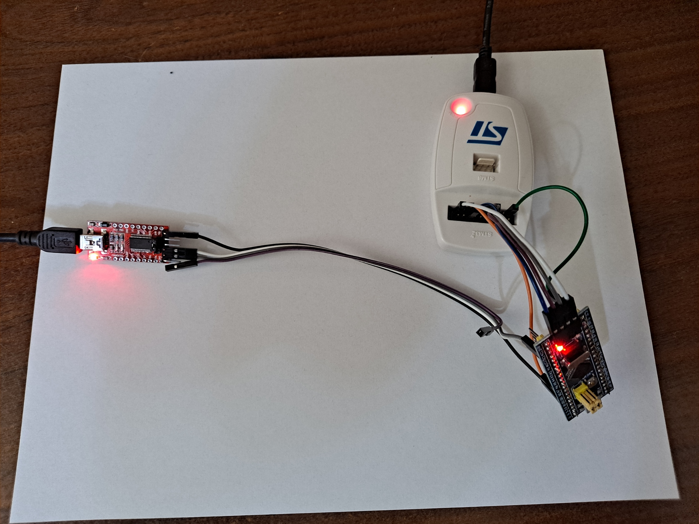

# STM32-F103C8T6_LittleFS 
**STM32-F103 with command line, Y-Modem, and LittleFS (using FLASH on the STM32-F103C8T6)**
 
This code base was originally developed for the NUCLEO-F103RB board (STM32-F103RB has 128KB of FLASH). 
The "Release" build (-Os) is about 40KBytes; the "Debug" build (-O0) is about 64KBytes. 
FLASH is split in half: application in the lower 64KBytes, LittleFS in the upper 64KBytes (0x08010000). 
The split is set in STM32F103C8TX_FLASH.ld and littlefs_interface.h; keep them matching. 
The "C8" part is rated for 64KB, but this Blue Pill's chip reports 128KB (OpenOCD "flash size = 128 KiB"). 
 
**Command line** (USART1, 115200 8N1) 
Command history (up / down arrow) and line editing (left / right, Home / End, Delete). 
Commands: help, cls, id, info, reset, timer, blink, dump, ymodem, version, 
ls, mkdir, rm, makefile, mv, cat, filedump, cp, readspeed. 
Modules live in their own folders under Core/ (Core/ymodem, Core/hexdump), each with a README.md. 
test/test_history.py checks history and line editing over the serial port. 
Version history: CHANGELOG.md 
 
 
Original setup: ST-Link V2 and FTDI serial board 
 
**Wiring Diagram for Blue Pill (STM32-F103C8T6)**  (Wire colors refer to the included picture) 
Using the ST-Link V2 - 20 pin JTAG connector  
|F103 Pin|Signal|Wire Color|ST-Link Pin|ST-Link Signal|
|---|---|---|---|---|
|JTAG-1|3.3V|White|19|3.3V (VDD)|
|JTAG-2|DIO|Gray|7|TMS_SWDIO|
|JTAG-3|CLK|Violet|9|TCK_SWCLK|
|JTAG-4|GND|Blue|4|GND|

**Additional wire adding NRST, making JTAG connections considerably faster**  
Connecting to STM32F103C8T6 pin 7 - NRST  
|F103 Pin|Signal|Wire Color|ST-Link Pin|ST-Link Signal|
|---|---|---|---|---|
|7|NRST|Blue|15|NRST|

**Serial Interface** (Different cable) 
FTDI board jumpered for 3.3V.  The console moved from USART2 (PA2/PA3, as in the picture) to USART1. 
|F103 Pin|Signal|Wire Color|FTDI Board PIN|
|---|---|---|---|
|PA9|USART1_TX|Gray|FTDI_RX|
|PA10|USART1_RX|White|FTDI_TX|
|GND|Ground|Black|FTDI_GND|

**Alternative: Raspberry Pi Pico running debugprobe** (SWD and serial on one USB cable) 
Flash with OpenOCD: interface/cmsis-dap.cfg, target/stm32f1x.cfg 
|Pico Pin|Pico Signal|Blue Pill|
|---|---|---|
|4|GP2 (SWCLK)|DCLK (SWD header)|
|5|GP3 (SWDIO)|DIO (SWD header)|
|3|GND|GND|
|36|3V3(OUT)|3.3 (Blue Pill USB unplugged)|
|6|GP4 (UART TX)|PA10 (USART1_RX)|
|7|GP5 (UART RX)|PA9 (USART1_TX)|
  
Reference Information: 
https://www.st.com/resource/en/user_manual/um1075-stlinkv2-incircuit-debuggerprogrammer-for-stm8-and-stm32-stmicroelectronics.pdf 
https://waterpigs.co.uk/articles/black-blue-pill-stm32-st-link-connection/ 
Blue Pill pinout: https://deepbluembedded.com/stm32-blue-pill-pinout-programming-guide/ 
 
Raspberry Pi Pico as an SWD probe (debugprobe firmware): 
Firmware source: https://github.com/raspberrypi/debugprobe 
Firmware download (debugprobe_on_pico.uf2): https://github.com/raspberrypi/debugprobe/releases 
Pico pinout: https://datasheets.raspberrypi.com/pico/Pico-R3-A4-Pinout.pdf 
Getting started with Pico: https://datasheets.raspberrypi.com/pico/getting-started-with-pico.pdf 
Debug Probe documentation: https://www.raspberrypi.com/documentation/microcontrollers/debug-probe.html 
